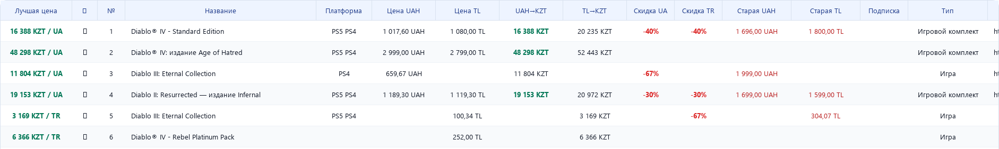
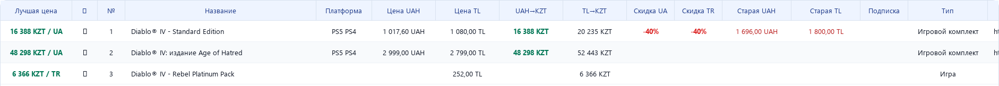

**Коммерческий проект для магазина Game Elysium.** Заказ оплачен владельцем, приложение используется в работе магазина.

PS Store Price Finder собирает предложения PlayStation Store по Украине и Турции в общую таблицу. Сотрудник находит нужную игру, сравнивает региональные цены и скидки, видит условия подписок и стоимость в тенге. Программа сокращает время ручного поиска и упрощает сравнение торговой информации.

[Скачать Windows-сборку](https://github.com/RedTowerInc/ps-store-price-finder/releases/latest) · [Как запустить](docs/quick-start.md) · [Версия 0.1.120](CHANGELOG.md)

## Рабочие сценарии

| Задача | Что делает приложение |
| --- | --- |
| Найти игру в двух регионах | Получает и сопоставляет предложения Украины и Турции |
| Сравнить стоимость | Показывает региональные цены, скидки и пересчёт в тенге |
| Учесть условия покупки | Отображает признаки PS Plus и EA Play |
| Уточнить выдачу | Поддерживает локальный фильтр и отбор дополнительного контента |
| Вернуться к нужным товарам | Сохраняет избранное и позволяет настроить столбцы таблицы |

## Интерфейс

Региональные предложения в одной таблице:

Применение локального фильтра к результатам:

*Фрагменты реального интерфейса приложения. Для изображений использована сохранённая выдача PlayStation Store от 04.11.2026.*

## Устройство приложения

**Python и PySide6 / Qt** используются для настольного приложения. Получение данных построено на **GraphQL API и Playwright**. Предложения из двух регионов сопоставляются и приводятся к общей форме для сравнения.

Кэширование и параллельная загрузка сокращают повторные обращения к источнику и время ожидания. Данные обрабатываются в JSON; Windows-сборка упакована с помощью PyInstaller и запускается без установленного Python.

## Мой вклад

Перевёл задачу магазина в требования к программе: определил логику поиска и сопоставления предложений, состав торговой информации и сценарии работы с таблицей. Проверял результаты поиска, воспроизводил ошибки и дорабатывал приложение по результатам использования.

В разработке использовал Codex. Задавал требования и логику работы, разбирал возникающие ошибки и проверял изменения на рабочих сценариях.

## Попробовать

1. Скачайте ZIP из [релиза](https://github.com/RedTowerInc/ps-store-price-finder/releases/latest).
2. Распакуйте архив целиком. Папка `_internal` должна оставаться рядом с `PSStorePriceFinder.exe`.
3. Запустите приложение на Windows 10/11 x64. Для поиска нужен интернет.
4. Введите название игры, например `diablo`, и нажмите «Поиск».

Подробности и сценарий знакомства с программой: [инструкция запуска](docs/quick-start.md).

---

**Андрей Мурзыков** · [Telegram: @AndyMooren](https://t.me/AndyMooren)

В репозитории опубликованы материалы проекта. Исходный код готов предоставить техническому специалисту отдельно.
